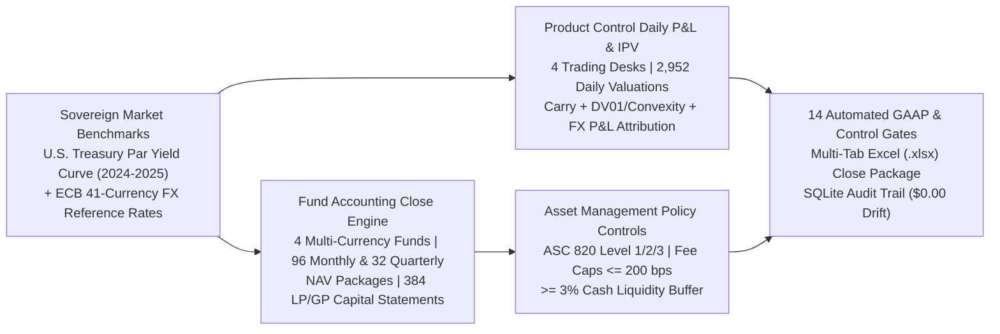

# Private Fund NAV, Multi-Currency Period-End Close & Product Control Daily P&L Suite

An end-to-end **Fund Accounting**, **Asset Management Fund Controls**, and **Product Controllers** financial reporting and internal-controls showcase executing across **222,050 European Central Bank (`ECB`) foreign-exchange observations** and **493 aligned 2024–2025 U.S. Treasury par-yield curve & FX trading days**.

---

## 1. System Architecture & Financial Control Pillars



1. **Fund Accounting (`ASC 946` & `ASC 830`):**
   - Prepares **96 monthly** and **32 quarterly** fund-level **Net Asset Value (`NAV`)** reporting packages across **4 multi-currency private equity, private credit, infrastructure, and liquid co-investment funds** (`$213.35M` ending combined NAV).
   - Generates **384 institutional LP/GP Investor Capital Statements** across **16 partner accounts**, enforcing exact pro-rata waterfall conservation ($\sum \text{Partner Ending Capital} = \text{Fund Ending NAV}$ with **`$0.00` variance**).
   - Automates period-end close adjustments: **mark-to-market (`MTM`) fair-value adjustments**, **foreign currency (`FX`) translation adjustments** (`EUR`, `GBP`, `CHF`, `USD`), **management fee accruals**, and **fund administrative/audit expense accruals**.
2. **Asset Management Fund Controllers (`ASC 820` & Policy Compliance):**
   - Enforces `ASC 820` Fair Value Hierarchy (`Level 1`, `Level 2`, `Level 3`) tagging, `>= 3.0%` unencumbered liquidity buffer thresholds, and `<= 200 bps` annualized management fee policy caps (`0` policy breaches).
3. **Product Controllers (Daily Trading P&L, Independent Valuation `IPV` & Risk Management):**
   - Computes **daily Profit & Loss (`P&L`)** across **4 trading desks** and **6 multi-currency fixed-income/FX positions (`2,952` daily position valuations)**, attributing **`99.91%`** of daily economic P&L into **Carry Accrual**, **Rate Duration/Convexity Move**, and **FX Spot Revaluation** with **`$0.00` total decomposition drift**.
   - Executes **Independent Price Verification (`IPV`)** (`10.0 bps` tolerance against sovereign U.S. Treasury & ECB benchmarks), intercepting **`32` stale front-office trader marks** and posting **`$922,275.58`** in pre-close General Ledger (`GL`) IPV adjustments (`0` unremediated FO-to-BO exceptions) alongside daily **`DV01`** risk limit checks (`$67,975.99` peak portfolio DV01 `< $75,000` limit).

---

## 2. Verified Public Datasets & Provenance

1. **Primary Dataset 1 — U.S. Department of the Treasury Official Daily Par Yield Curve (`2024` & `2025`):**
   - **2024 URL:** `https://home.treasury.gov/resource-center/data-chart-center/interest-rates/daily-treasury-rates.csv/2024/all?type=daily_treasury_yield_curve&field_tdr_date_value=2024&page&_format=csv`
   - **2024 SHA-256:** `6775840b76cd7fd41121f61d6f6c60184eca6b2ba49954ec7372c463cbeef34d`
   - **2025 URL:** `https://home.treasury.gov/resource-center/data-chart-center/interest-rates/daily-treasury-rates.csv/2025/all?type=daily_treasury_yield_curve&field_tdr_date_value=2025&page&_format=csv`
   - **2025 SHA-256:** `cf2fa3da7f160384b63d2ead698532b1d76cd9f789ce4911e2304db85b14e6d5`
2. **Primary Dataset 2 — European Central Bank (`ECB`) Historical Daily FX Reference Rates (`eurofxref-hist.zip`):**
   - **URL:** `https://www.ecb.europa.eu/stats/eurofxref/eurofxref-hist.zip`
   - **SHA-256:** `d3510cea39193a817380796d02d0cdf2ec492d4f3e18fe7ddb7383b15e043db5`
   - **Scale:** `7,138` historical FX fixing dates (`222,050` non-null sovereign FX spot observations; `493` aligned 2024–2025 business days).
3. **Backup Public Sources:**
   - **SEC EDGAR XBRL Company & Investment Fund Facts API:** `https://www.sec.gov/edgar/sec-api-documentation`
   - **Bank for International Settlements (`BIS`) Exchange Rate & Debt Securities Statistics:** `https://data.bis.org/`

---

## 3. Verified Empirical Results (`outputs/controllers_validation_summary.json`)

| Capability / Control Metric | Verified Output |
| :--- | :--- |
| **Aligned Sovereign Market Trading Days (`2024–2025`)** | `493` days (`222,050` total ECB FX observations) |
| **Monthly & Quarterly Fund NAV Packages** | `96` monthly packages / `32` quarterly packages across `4` funds |
| **Ending Combined Fund NAV (`2025-12`)** | `$213,348,894.49` (`$213.35M`) |
| **LP / GP Investor Capital Statements** | `384` partner statements across `16` institutional accounts (`$0.00` waterfall variance) |
| **Daily Trading-Desk Position Valuations** | `2,952` position-days across `4` desks (`99.91%` Taylor P&L attribution accuracy) |
| **Independent Price Verification (`IPV`) Exceptions Remediated** | `32` stale trader marks intercepted (`$922,275.58` GL adjustments; `0` unadjusted breaches) |
| **Internal Control & GAAP Audit Gates** | `14 / 14 passed (100.0%)` + `7 / 7` unit tests (`OK`) |

---

## 4. Repository Structure & Reproducibility

- `src/fund_nav_and_pnl_engine.py` — End-to-end Python & SQLite Fund Accounting NAV, Investor Waterfall, Asset Management Control, Product Control Daily P&L/IPV, and Excel `.xlsx` Close Package generator.
- `sql/fund_nav_and_pnl_reconciliation.sql` — Analytical `SQL Joins & CTEs` validating `$0.00` NAV roll-forward, investor capital waterfall, and FO-to-BO P&L parity.
- `docs/accounting_controls_and_schema.md` — `ASC 946`, `ASC 820`, and `ASC 830` accounting control rules and table grain definitions.
- `outputs/fund_nav_and_daily_pnl_close_package.xlsx` — Multi-sheet Excel close package (`Fund_NAV_Close_Schedule`, `Investor_Capital_Statements`, `Daily_Product_PnL_IPV`).
- `outputs/controllers_validation_summary.json` — Verified hashes, metrics, and 14-gate audit receipt.
- `tests/test_fund_nav_product_control.py` — Automated `unittest` suite (`7/7` tests passing).

```bash
python3 src/fund_nav_and_pnl_engine.py
python3 -m unittest discover -s tests -v
```
